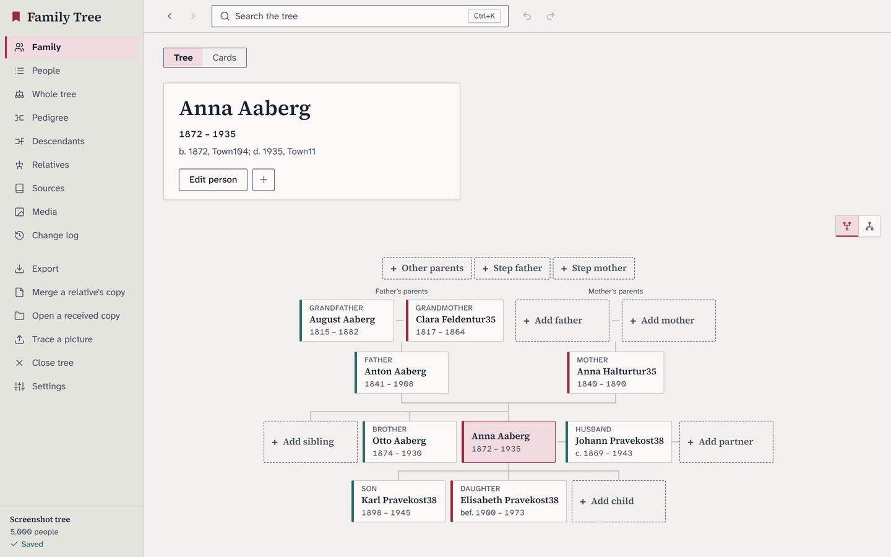
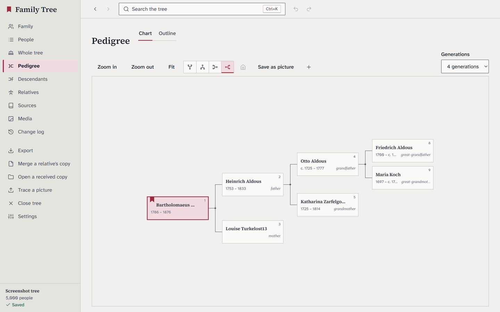
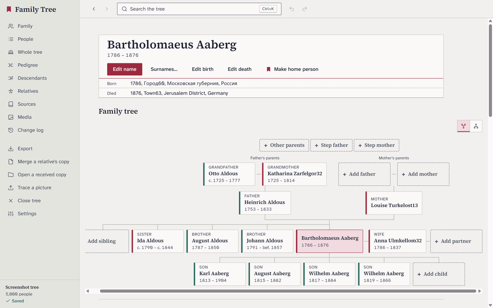
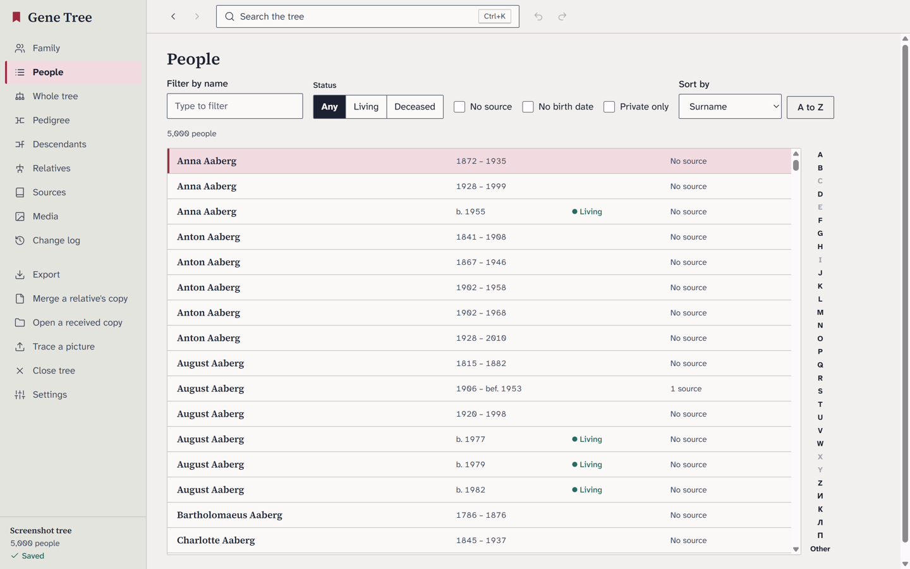
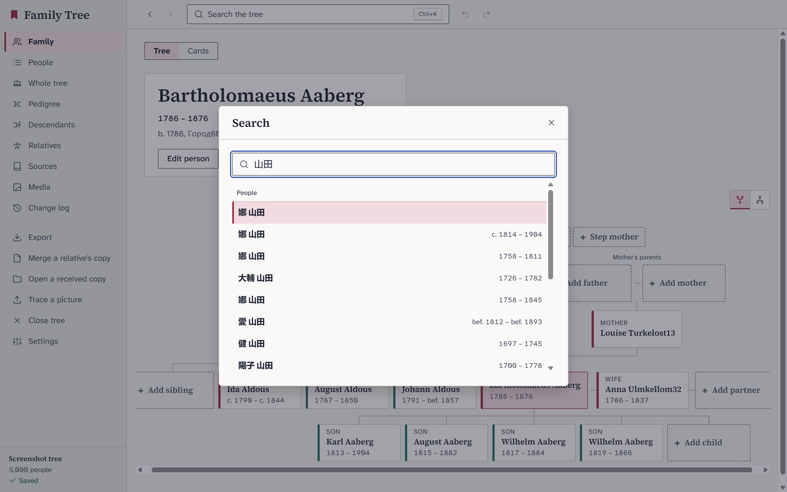
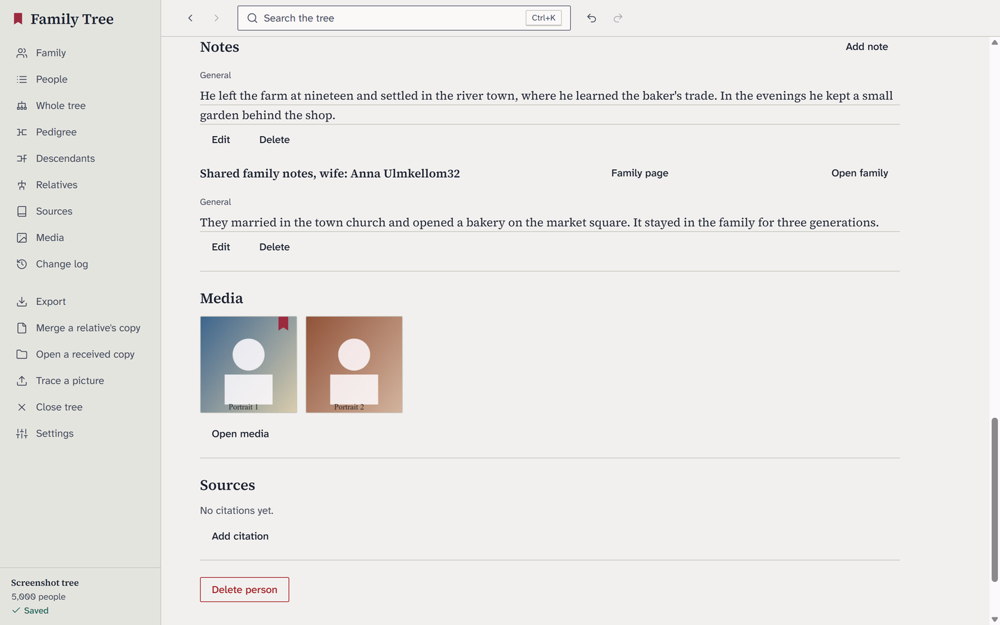
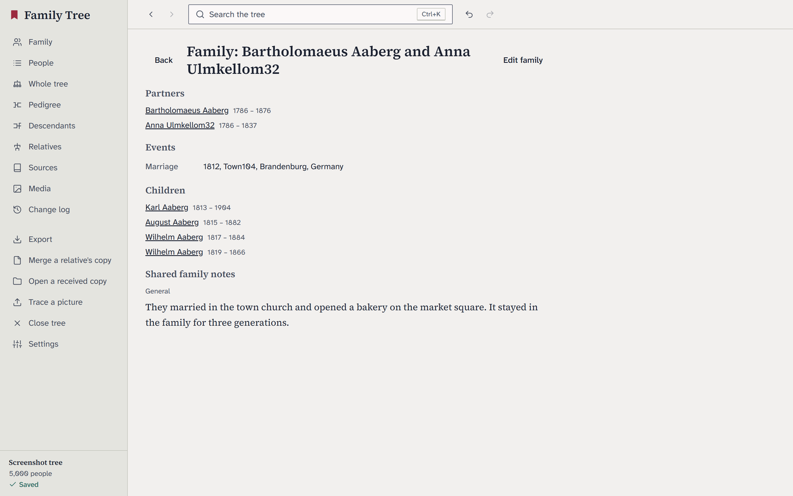
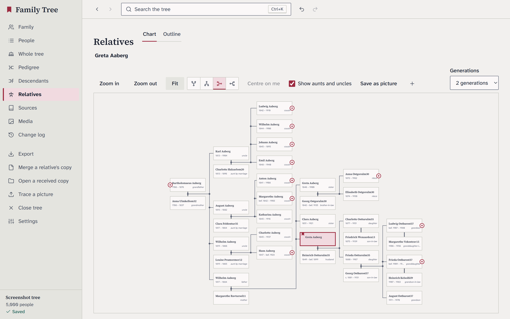
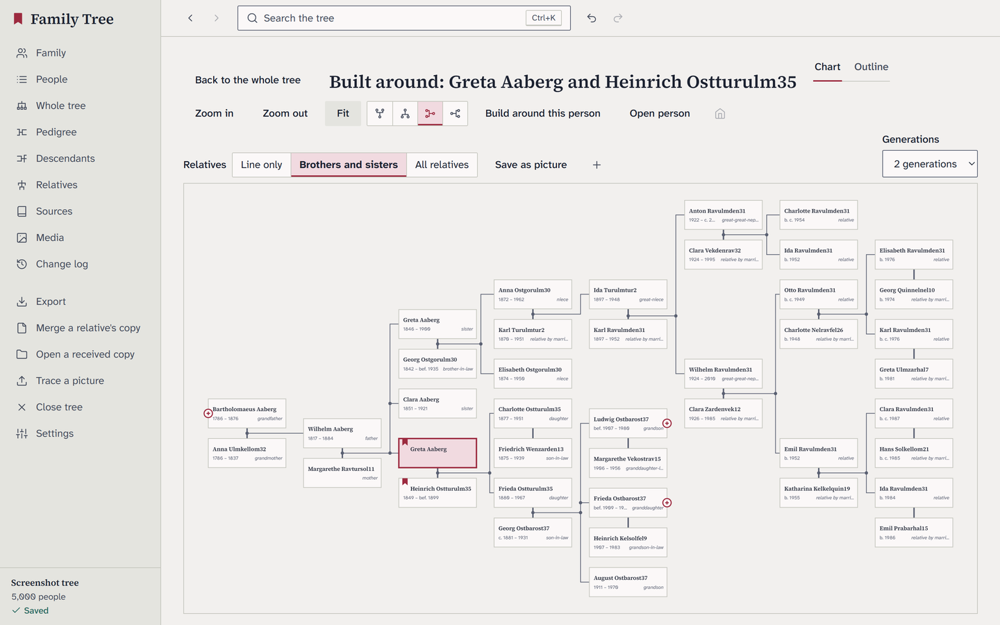
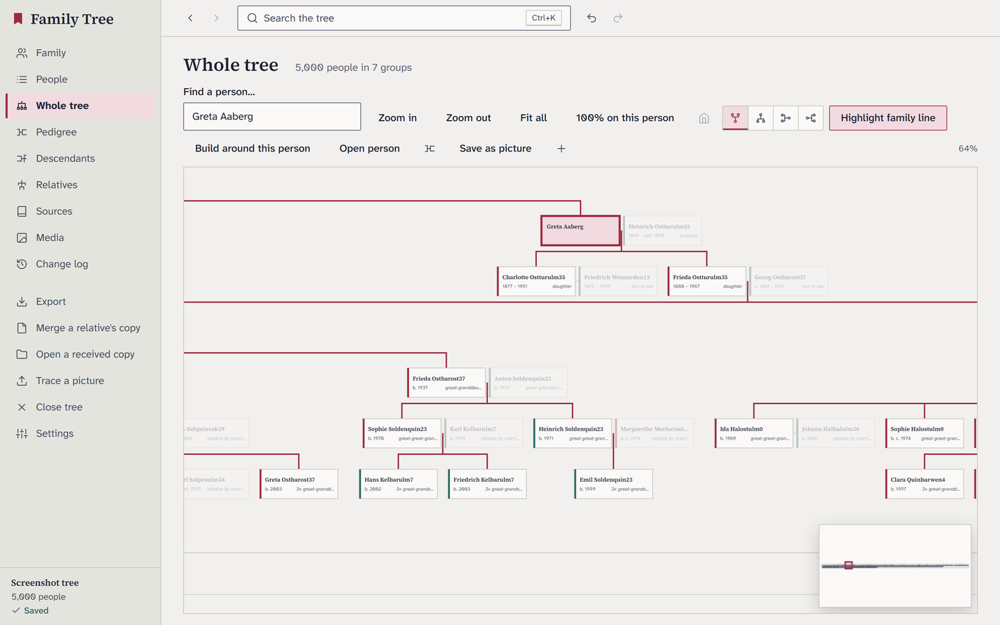

<div align="center">

# Family Tree

**A fast, private genealogy app for your desktop.**
Your family history stays on your computer, in open formats, and is yours to keep.

[](https://github.com/nazymko/family-tree/actions/workflows/ci.yml)
[](https://github.com/nazymko/family-tree/releases/latest)
[](#license)


[**Download**](https://github.com/nazymko/family-tree/releases/latest) ·
[Report a bug](https://github.com/nazymko/family-tree/issues/new?template=bug_report.yml) ·
[Suggest a feature](https://github.com/nazymko/family-tree/issues/new?template=feature_request.yml) ·
[Contribute](CONTRIBUTING.md)



</div>

## Why Family Tree

- **Private by default.** No account, no cloud, no tracking. A tree is a folder on your disk with a SQLite database and
  your photos. Living people are protected by a privacy rule on every export.
- **Open formats in and out.** Imports GEDCOM 5.5.1 and 7 (including GEDZIP), Gramps XML and Древо Жизни (`.atdb`);
  exports GEDCOM back without losing what it does not understand.
- **Built for large trees.** Tens of thousands of people stay smooth: charts are laid out in Rust and drawn on a canvas.
- **Bilingual.** English and Ukrainian, including the kinship terms (cousins, in-laws, «троюрідний брат»).

## Features

| | |
|---|---|
| **Family view** | A person with parents, grandparents, brothers and sisters, partners and children, every card one click from editing. |
| **Charts** | Pedigree, descendants, relatives, the whole tree, and *Build around* one or several chosen people with their brothers, sisters and all relatives. Zoom, pan, save as a picture. Each chart has an accessible outline view. |
| **Editing** | Names (with maiden names), events with a live date preview, places, sources and citations, notes, media. Every edit can be undone, and each record keeps its history. |
| **Search** | One box over every name variant, diacritic-insensitive, with phonetic matching, plus places, notes and sources. |
| **Media** | Drag in photos and documents; thumbnails, EXIF dates, a zoomable viewer. |
| **Sharing with relatives** | *Send a copy* of the tree as one file; *merge a relative's copy* back with a preview. Nothing is merged without your review. |
| **AI agent access** (optional) | A local MCP server lets an AI agent on the same computer read the open tree and suggest additions, every change attributed and undoable. Off by default. See [docs/agent-access.md](docs/agent-access.md). |
| **Backups** | Automatic timestamped backups and a crash-safe store. |

<table>
  <tr>
    <td></td>
    <td></td>
  </tr>
  <tr>
    <td></td>
    <td></td>
  </tr>
  <tr>
    <td></td>
    <td></td>
  </tr>
  <tr>
    <td></td>
    <td></td>
  </tr>
  <tr>
    <td></td>
    <td></td>
  </tr>
</table>

<sub>All screenshots show a generated test tree; no real people.</sub>

## Install

Download the file for your system from the [latest release](https://github.com/nazymko/family-tree/releases/latest):

| System | File |
|---|---|
| Windows 10/11 | `Family-Tree-<version>-windows-x64-setup.exe` (installer) or `...-portable.exe` (no install) |
| macOS 11+ | `Family-Tree-<version>-macos-universal.dmg` (Apple Silicon and Intel) |
| Linux | `Family-Tree-<version>-linux-x86_64.AppImage`: `chmod +x` it, then run it |

The builds are not code-signed yet. On Windows, SmartScreen asks first: choose **More info**, then **Run anyway**. On
macOS, right-click the app and choose **Open**. Want the newest changes before a release? Try the
[nightly build](https://github.com/nazymko/family-tree/releases/tag/nightly).

## Build from source

You need [Rust](https://rustup.rs) (the toolchain in `rust-toolchain.toml` installs itself), Node.js 20+ and, on Linux,
the WebKitGTK packages listed in [docs/release.md](docs/release.md).

```bash
git clone https://github.com/nazymko/family-tree.git
cd gene-tree/app
npm ci
npm run tauri dev          # run the app with hot reload
npm run tauri build        # a release build with installers
```

Tests: `bash scripts/test.sh` (everyday), `--quick` (only what your change affects), `--full` (everything CI runs),
`--e2e` (the real app driven through WebDriver). See [docs/testing.md](docs/testing.md).

## How it is built

| Part | Where |
|---|---|
| Desktop shell | [Tauri 2](https://tauri.app), `app/src-tauri` |
| Interface | [Svelte 5](https://svelte.dev) + TypeScript, `app/src` |
| Data model, dates, kinship | `crates/gt-core`, `crates/gt-session` |
| Storage (SQLite, FTS5 search) | `crates/gt-store` |
| Chart layouts | `crates/gt-layout` |
| Import and export | `crates/gt-gedcom`, `gt-import`, `gt-import-gramps`, `gt-import-atdb` |
| Agent access (MCP) | `crates/gt-mcp` |

Design notes are in [docs/](docs), decisions in [docs/adr](docs/adr).

## Releases

A new version comes out on the 1st of every month when there is something new, built for all three systems and
published on the [releases page](https://github.com/nazymko/family-tree/releases) with notes made from the changes.
A nightly pre-release follows `main` every day it changes. Details: [docs/release.md](docs/release.md).

## Contributing

Bug reports, ideas and pull requests are welcome. Fork the repository, make your change on a branch, and open a pull
request against `develop`. [CONTRIBUTING.md](CONTRIBUTING.md) explains the setup, the tests and the one firm rule:
**never put real people's data in an issue, test or commit.** Use invented names.

## License

Family Tree is dual-licensed under either of

- [MIT License](LICENSE-MIT)
- [Apache License, Version 2.0](LICENSE-APACHE)

at your option. Bundled fonts and third-party code are listed in [THIRD_PARTY.md](THIRD_PARTY.md).
